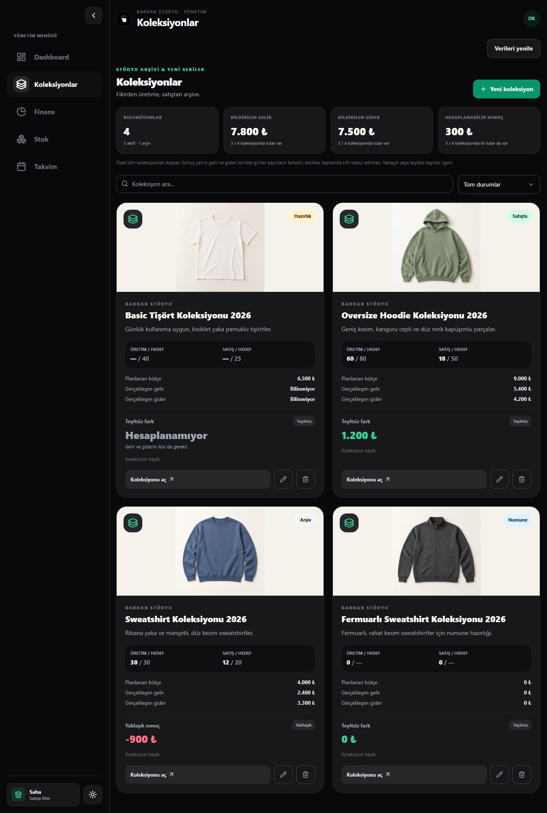

# BardakOS

React, TypeScript ve Tailwind ile koleksiyon yönetimi ve saha satış akışları.

**Bütün başlangıç kayıtları ve hesaplar kurgusaldır.** Gerçek kişi, banka/ödeme hesabı veya işletme muhasebesi yoktur. Gerçek tahsilat yapılmaz.

## Kullanım

Node 24 (yerelde 24.18.1 ile doğrulandı):

```sh
npm ci
npm run dev -- --host 127.0.0.1 --port 5173 --strictPort
```

Ayarsız çalıştırma yerel önizlemedir. Gerçek kurgusal Supabase çalışma alanına bağlanmak için `.env.example` dosyasını Git dışındaki `.env.local` dosyasına kopyalayıp aşağıdaki alanları doldurun. Proje bağlantı değerleri pakete dahil değildir.

| Ortam adı | Bağlantı ayarı |
|---|---|
| VITE_DATA_MODE | supabase |
| VITE_SUPABASE_URL | Yetkilendirilen kurgusal projenin URL'si |
| VITE_SUPABASE_PUBLISHABLE_KEY | Yalnız publishable veya legacy anon anahtarı |
| VITE_ENABLE_DEMO_ACCOUNTS | true; gerçek kullanıma geçerken false/boş |

Hiçbir VITE değişkenine secret/service_role, DB parolası veya kişisel erişim tokenı girilmez. Public anahtar tarayıcıda görünür; veri erişimini Auth, sunucu üyeliği, kolon izinleri ve RLS korur. Eksik/hatalı cloud ayarı veya başarısız Auth isteği yerel hesaba sessiz geçiş yapmaz.

## Test hesapları

Yalnız örnek çalışma alanı için herkese açık test bilgileridir:

| Profil | E-posta | Parola |
|---|---|---|
| Yönetici | yonetici@bardakos.example | Yonetim2026! |
| Saha çalışanı | saha@bardakos.example | Saha2026! |

`Bilgileri doldur` yalnız alanları doldurur. Kullanıcı `Giriş yap` düğmesine basar; gerçek Supabase parola doğrulaması ve sunucu rolü uygulanır. Otomatik giriş/rol atama/bypass yoktur. Bulutta panel yalnız `VITE_ENABLE_DEMO_ACCOUNTS=true` ile gösterilir; önizlemede yerel hesaplar ayrıca görünür. Başka projede bu hesapların ayrıca kurulması gerekir; kullanıcıları uygulama kendiliğinden oluşturmaz.

## Çalışan kapsam ve veri ömrü

- Yönetici: koleksiyon liste/arama/filtre, oluştur/düzenle/onaylı sil; koleksiyon içinde ürün, üretim adımı ve reklam/çekim CRUD'u; katalog dosyası ekleme/önizleme/kaldırma.
- Supabase modunda Auth oturumu, profil ad/notu ve koleksiyon+içerik/dosya referansları kalıcıdır; yenileme ve tekrar girişle doğrulandı. Rol ve üyelik sunucudan gelir. Saha yalnız saha arayüzüne erişir.
- Saha sepet/satış/geri alma, stok/transfer/kasa, yönetim gider ve takvim oturum belleğindedir; yenileme/çıkışta sıfırlanır. Dashboard/Finans grafik bazları kurgusaldır; gerçek muhasebe değildir.
- Yerel önizlemede bütün çalışma verileri yenileme/çıkışta sıfırlanır. Tema açık oturum içindir; yenilemede varsayılana döner.
- Dosyalar sabit yerel katalog kaynaklarıdır; dış upload/Storage yoktur. Realtime/çakışma çözümü yok; aynı kayıtta son yazan kazanır. Ağ hatasında yeniden eklemeden önce listeyi yenileyin.
- Profil Geri düğmesi önceki sayfa, koleksiyon/alt sekme, filtre ve kaydırmayı korur. Kompakt marka/başlık/profil alanı içerikle doğal kaydırılır; sabit blok veya fotoğraf üstünde yüzen şerit yoktur.
- Saha örneği Basic Tişört, Adaçayı/Kırık beyaz, S–XXL ve 300 ₺ birim fiyat kullanır. Başlangıçta araç+tezgâhta 78 hayali adet, ayrıca 3 adet bekleyen transfer vardır. Teknik renk kimlikleri değişmeden ortak etiket/palet ve işlem detayları kullanılır. Bu, koleksiyon finansına veya Supabase saha stoklarına otomatik bağlantı değildir.

## Ekran görüntüleri



[Açık tema koleksiyonları](screenshots/collections-light.jpg) · [Giriş ve test hesapları](screenshots/login-light.jpg)

[Kurgusal stok açık tema](screenshots/stock-light.jpg) · [Kurgusal stok koyu tema](screenshots/stock-dark.jpg)

Ürün fotoğrafları bu uygulama için yapay zekâyla üretildi; gerçek ürün/kişi fotoğrafı değildir. Kaynak ve prompt kaydı: [public/product-images/SOURCES.md](public/product-images/SOURCES.md).

## Kontroller ve Netlify hazırlığı

```sh
npm run typecheck
npm run lint
npm test
npm run build
```

60 otomatik test; gerçek Supabase projesinde 37 Auth/API kontrolü, kalıcılık kabulü ve tarayıcı kontrolleri. PGlite dev bağımlılığı yalnız yerel SQL testlerindedir. Gerçek cihaz ve uzakta ikinci yönetici/başka workspace senaryoları ayrıca doğrulanmalıdır.

`netlify.toml`: Node 24, `dist` çıktı klasörü, tür/lint/test/build ve gerekli public cloud env kontrolü. SPA fallback `public/_redirects` dosyasındadır. Netlify hedef hesabı/site ve tam kaynak paketi onaylandıktan sonra build kapsamındaki URL/public anahtar ortamdan verilir; source dosyaya yazılmaz. Yapılandırma [Netlify Vite](https://docs.netlify.com/build/frameworks/framework-setup-guides/vite/), [dosya tabanlı ayarlar](https://docs.netlify.com/build/configure-builds/file-based-configuration/) ve [SPA rewrite](https://docs.netlify.com/manage/routing/redirects/rewrites-proxies/) belgelerine dayanır.

Canlı uygulama: [BardakOS](https://bardakos.netlify.app/). Kaynak kod: [GitHub](https://github.com/Ogisans/BardakOS). Bağlı mevcut Supabase projesinde migration/seed/reset'i tekrar çalıştırmayın. Başka boş projeye kurulum: [supabase/README.md](supabase/README.md).

Mevcut canlı sürüm Netlify Drop ile yayımlanmıştır; GitHub pushları otomatik deploy tetiklemez. Kod değişikliklerinde Supabase bağlantı ayarlarıyla yeniden production build alınıp Netlify’a yüklenmelidir.
